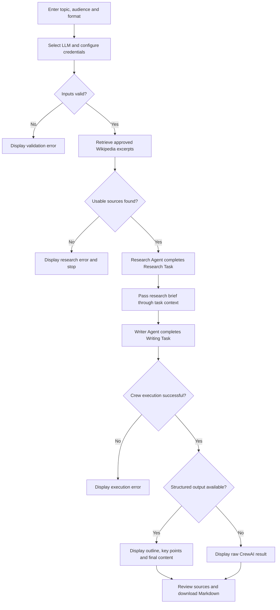

# CrewAI Agent/Task Flow — Content Research and Writing Application

The Content Research and Writing application uses **Streamlit** as its user interface and **CrewAI** to coordinate two agents: an Evidence Researcher and a Content Writer. Its objective is to transform a user’s topic into an outline, key points, and a final article or LinkedIn-style post supported by identifiable sources.

The workflow begins when the user enters a topic, specifies the intended audience, selects an output format, and chooses an approximate word count. The user also selects an LLM provider: OpenAI or a local Ollama model. Configuration defaults are loaded from environment variables. An OpenAI API key can be supplied through a `.env` file or a masked password field.

Before execution, the application validates the topic, audience, model name, and required credentials. It then searches the approved English Wikipedia API and retrieves up to four introductory source excerpts. Each source receives an identifier, such as **S1**, together with its title and URL. If retrieval fails or returns no usable evidence, the application displays an error and stops the workflow.

The **Evidence Researcher Agent** has a clearly defined role, goal, and backstory describing a careful research librarian. Its Research Task instructs it to identify relevant facts, attach source identifiers, and report evidence gaps. The agent can use a custom CrewAI tool, `ApprovedEvidenceTool`, to inspect the retrieved source corpus. The same corpus is included in the task description to ensure that evidence remains available throughout execution.

The **Content Writer Agent** acts as a writer and editor. Its Writing Task receives the Research Task’s output through CrewAI’s task context. It develops the outline, key points, and final content for the selected audience and format. Instructions require factual claims to use source citations and prohibit invented statistics, quotations, or URLs. When evidence is insufficient, the writer should explain the limitation.

Both agents and tasks are connected through a **Crew** configured with a sequential process. Calling `crew.kickoff()` executes research first and writing second. The final task requests a structured Pydantic output containing a title, outline, key points, content, and limitations.

Streamlit presents the results in separate tabs for final content, planning, sources and research, and the actual CrewAI execution result. Users can inspect the evidence and download the draft as Markdown. If structured output is unavailable, the application displays the raw result. These controls improve transparency, although citation accuracy and factual support still require human review.

## Workflow and Decision Chart

The two agent tasks run inside the sequential Crew; source retrieval and input validation happen before `crew.kickoff()`.
